<!-- ===================== BANNER ===================== -->
<p align="center">
  
</p>

<!-- ===================== TYPING ===================== -->
<p align="center">
  <a href="https://github.com/luisbravobello">
    
  </a>
</p>

<p align="center">
  
  
  
</p>

<p align="center">
  <a href="mailto:luisbravobello@gmail.com"></a>
  <a href="https://www.linkedin.com/in/luis-alejandro-bravo-bello-94606535a/"></a>
  <a href="https://github.com/luisbravobello/portfolio"></a>
</p>

## About me

I build applications that solve real problems, working across **backend systems**, **frontend interfaces** and **databases**. I care about readable code, clear responsibilities and architectures that can grow with a project.

-  &nbsp;**Education:** Software Engineering student at **Universidad Central del Este (UCE)**
-  &nbsp;**Location:** Based in **Punta Cana, Dominican Republic**
-  &nbsp;**Main stack:** **C#**, **.NET** and **SQL** for backend systems and APIs
-  &nbsp;**Computer graphics:** 3D scenes and simulations with **C + OpenGL**
-  &nbsp;**Currently learning:** **JavaScript**, **Spring Boot** and **3D modeling with Blender**
-  &nbsp;**Open to:** Collaborating on projects and learning opportunities

```csharp
var luis = new Developer
{
    Name     = "Luis Alejandro Bravo Bello",
    Role     = "Full Stack Developer",
    Stack    = ["C#", ".NET", "SQL", "JavaScript", "C"],
    Focus    = ["Clean Architecture", "Web Security", "3D Modeling"],
    Motto    = "Start with the problem, then choose the tool."
};
```

## Tech stack

<p align="center">
  
</p>

## Featured projects

<table>
  <tr>
    <td width="50%" valign="top">
      <h3><a href="https://github.com/luisbravobello/envDoctor">EnvDoctor</a></h3>
      <p>Diagnoses why a project doesn't build, start or behave the same across machines, combining deterministic rules with an AI assistant that always cites its evidence.</p>
      
      
      
      
      
    </td>
    <td width="50%" valign="top">
      <h3><a href="https://github.com/luisbravobello/MiniBuz-Seguro">MiniBuzón Seguro</a></h3>
      <p>Report-box system with an admin panel, built around four web security protections: SQL Injection, XSS, CSRF and malicious file uploads.</p>
      
      
      
    </td>
  </tr>
  <tr>
    <td width="50%" valign="top">
      <h3><a href="https://github.com/luisbravobello/estacion-tren-opengl">Estación Central 3D</a></h3>
      <p>3D train station simulation in C with OpenGL and GLUT: multiple viewports, night mode and a lighting lab.</p>
      
      
    </td>
    <td width="50%" valign="top">
      <h3><a href="https://github.com/luisbravobello/Simulador-Aliasing--MSAA-Y-SAOO">Aliasing, MSAA & SSAO Simulator</a></h3>
      <p>Interactive educational simulator that visualizes aliasing, multi-sample anti-aliasing and ambient occlusion with a retro arcade spaceship.</p>
      
      
    </td>
  </tr>
  <tr>
    <td width="50%" valign="top">
      <h3><a href="https://github.com/luisbravobello/pokeatlas">PokéAtlas</a></h3>
      <p>Pokémon reference site: Pokédex by region, type matchups, items and a Kanto guide. Pure HTML, CSS and JavaScript.</p>
      <a href="https://pokeatlas.pages.dev/"></a>
      
    </td>
    <td width="50%" valign="top">
      <h3><a href="https://github.com/luisbravobello/costa-clara">Costa Clara</a> · <a href="https://github.com/luisbravobello/full-time">FULL TIME</a></h3>
      <p>Published websites showcased in my portfolio.</p>
      <a href="https://costa-clara.pages.dev/"></a>
      <a href="https://full-time-edb.pages.dev/"></a>
    </td>
  </tr>
</table>

<p align="center">
  <a href="https://github.com/luisbravobello?tab=repositories"></a>
</p>

## GitHub stats

<p align="center">
  
</p>

<p align="center">
  
</p>

## Contribution Pac-Man

<p align="center">
  <picture>
    <source media="(prefers-color-scheme: dark)" srcset="https://raw.githubusercontent.com/luisbravobello/luisbravobello/output/pacman-contribution-graph-dark.svg?v=2" />
    <source media="(prefers-color-scheme: light)" srcset="https://raw.githubusercontent.com/luisbravobello/luisbravobello/output/pacman-contribution-graph.svg?v=2" />
    
  </picture>
</p>

## Let's connect

Have a project, an idea or a learning opportunity to share? Write me at **[luisbravobello@gmail.com](mailto:luisbravobello@gmail.com)**.

<p align="center">
  <a href="https://www.linkedin.com/in/luis-alejandro-bravo-bello-94606535a/"></a>
  <a href="https://www.instagram.com/alejandro_bravo27/"></a>
  <a href="https://www.x.com/luisbravobello1"></a>
  <a href="https://www.facebook.com/luisalejandrobravobell"></a>
  <a href="mailto:luisbravobello@gmail.com"></a>
</p>

<p align="center">
  
</p>
